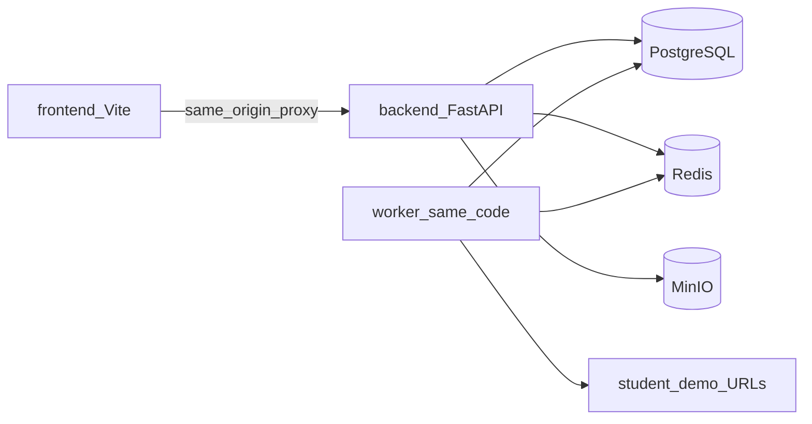
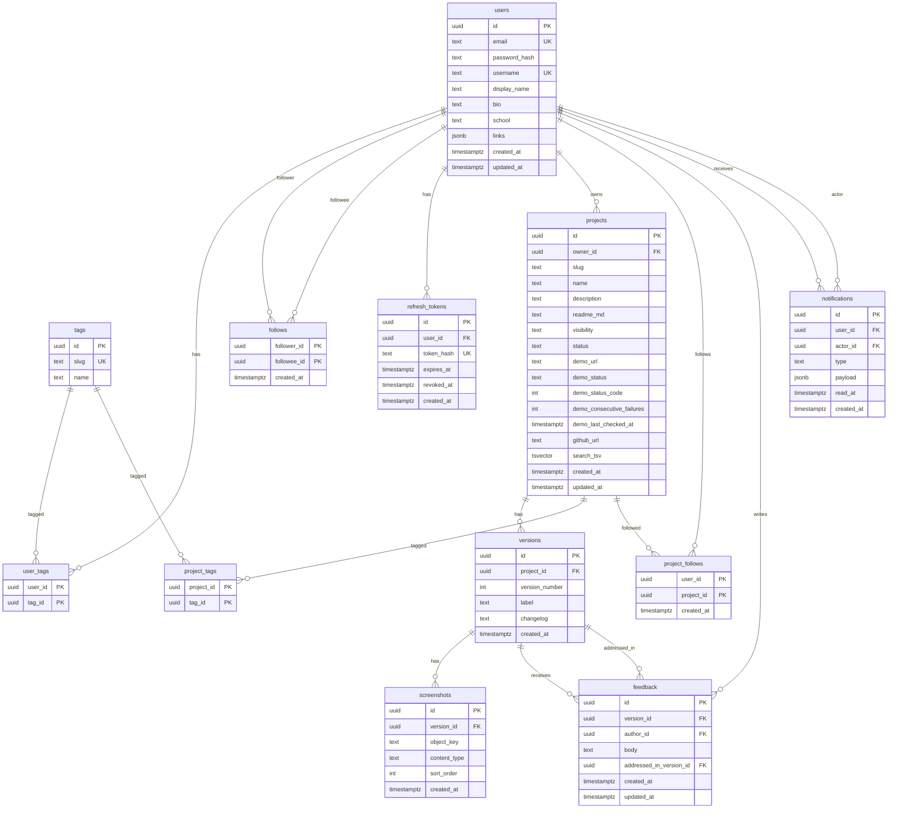

# Steam for Students — MVP implementation plan

Working title stays **Steam for Students** in docs/code comments until you pick a real name. Signup is open to anyone; **school is optional free text** on the profile. No student-email gate.

**Locked choices:** email/password + **cookie-based JWT** (access JWT in an httpOnly cookie; not a server session store); no email verify, no password reset, no SSO; React + TypeScript + Vite + Tailwind + React Router + TanStack Query + shadcn/ui; GitHub import via public REST API only; any logged-in viewer can leave flat feedback (not on their own project); public/unlisted/private as classic; unlisted share URLs are unguessable (`/p/{uuid}`); Postgres FTS on `search_tsv` (name, description, tags); MinIO locally → Cloudflare R2 later; 5 screenshots/version; demo ping every 15 minutes with 3-strike hysteresis; Compose locally, one VPS in prod, GitHub Actions CI, manual deploy.

---

## Architecture (why this shape)

One FastAPI process for HTTP, one **worker process** sharing the same code and DB, Redis for rate limits/cache, MinIO for screenshots. Modules are Python packages with clear boundaries (`users`, `projects`, `feed`, `notifications`) so you can extract a service later without rewriting tables.

**Rejected:** microservices now (you will spend the semester on Docker networking, not product). **Rejected:** a “smart” repository layer plus CQRS (too much indirection for one student). Each module is `router.py` / `schemas.py` / `models.py` / `service.py`. Routers stay thin; services own transactions and permission checks.




Dev: Vite proxies `/api` → FastAPI so cookies are **same-site**. Prod: nginx on one host serves the SPA and `/api` (same origin). That is why cookie-based JWT works without a brittle CORS+CSRF story.

**Rejected:** JWT in `localStorage` (XSS can steal it; you asked for resume-grade correctness). **Rejected:** split frontend/API domains in MVP (forces SameSite=None, HTTPS, CSRF tokens). **Rejected:** classic server-side session cookies (a `sessions` table of opaque IDs) — we still use JWTs so the API stays stateless for the access token; cookies are only the **transport**, not a session store.

---

## Folder structure and naming

```
the-project/
  backend/
    app/
      main.py                 # FastAPI app factory
      worker.py               # APScheduler entrypoint
      core/                   # config, db, redis, security, storage
      modules/
        users/                # auth, profiles, tags, user-follow
        projects/             # projects, versions, screenshots, github, project-follow, demo fields
        feed/                 # feed + search
        notifications/
      dependencies.py
    alembic/
    tests/
    pyproject.toml
  frontend/
    src/
      pages/
      components/             # ui/ = shadcn; domain components by feature
      lib/                    # api client, auth, queryClient
      hooks/
    index.html
  docker-compose.yml          # api, worker, web, postgres, redis, minio
  docker-compose.prod.yml
  nginx/                      # prod reverse proxy
  .github/workflows/ci.yml
```

**Naming**

- Python: `snake_case` modules; tables **plural snake_case**; PK `id` UUID; FKs `{entity}_id`.
- HTTP: `/api/v1/...`, **kebab-case** path segments, JSON **snake_case** (FastAPI default). Do not camelCase the API just to please React — map in the client if needed, or just use snake_case in TS types. One convention is less bugs.
- React: `PascalCase` components, `camelCase` hooks, route files matching URLs.
- Git: `main` only for MVP; short PR branches `feat/auth-cookies`, `fix/visibility-acl`.

**Env:** `backend/.env.example` + Compose `env_file`. Never commit secrets. Config via Pydantic `Settings`.

---

## Database schema

**Decisions**

- UUID PKs (safe to expose; no sequential ID leaking “how many users”).
- Join tables: **composite primary keys**, as you specified.
- `created_at` on every major table; `updated_at` only where rows mutate (users, projects, feedback, notifications.read_at).
- Enums as `**TEXT` + `CHECK**`, not Postgres ENUM types. **Rejected:** native ENUMs (Alembic alters are painful).
- **Creating a project always creates v1.** Screenshots and feedback hang off versions; a project with zero versions is an illegal state.
- **Versions have an integer `version_number` (source of truth) plus an optional `label`** (e.g. `"v2 - dark mode"`). Ordering, uniqueness, and “later version” checks use `version_number` only. Label is display-only, unique-not-required, max ~80 chars.
- **Project tags exist** even though you listed interest tags on users. The feed is tag overlap; without `project_tags` there is nothing to overlap. Import maps GitHub languages onto the same `tags` table.
- **Unlisted URLs are unguessable.** Public projects keep a name-derived `slug` and `/u/{username}/{slug}`. Unlisted share URL is `/p/{project.id}` (UUID). Unlisted `slug` is a random 16-char nanoid, never derived from the title, so `/u/{username}/{pretty-name}` 404s. Flipping public→unlisted **rotates** the slug (old pretty URL dies). Flipping unlisted→public assigns a name-derived slug.
- Profile links: **JSONB** `links` `[{label, url}]` on `users`. **Rejected:** `user_links` table (three URLs do not need a join).
- No avatar upload in MVP (initials in the UI). Reuse MinIO later if you want photos.
- Counts (`followers`, `feedback`) are queried live. `**project_stats` stays unbuilt**; add a table later, do not denormalize now.

### ER diagram




### Columns, constraints, indexes (detail)

**users:** `email` and `username` stored **lowercase**, unique. Username `[a-z0-9_]{3,30}`. `links` max ~5 entries, validated URLs. Optional `school` varchar(120).

**follows:** PK `(follower_id, followee_id)`; `CHECK (follower_id <> followee_id)`. Extra index `**follows(followee_id)`** (PK leads with `follower_id`, so lookups of “who follows X” need this). Optional composite `(followee_id, created_at DESC)` can replace the single-column index if we want sorted follower lists without a sort.

**refresh_tokens:** store **SHA-256 hash** of the refresh token, never plaintext. Index `(user_id)` for logout-all. Logout deletes/revokes rows.

**projects:** unique `(owner_id, slug)`; `visibility IN ('public','private','unlisted')`; `status IN ('planning','active','completed','archived')`; `demo_status IN ('unknown','up','down')`; `demo_consecutive_failures INT NOT NULL DEFAULT 0`; `demo_status_code` nullable. Index `(visibility, updated_at DESC)` for discovery. Partial index on `demo_url IS NOT NULL` for the worker.

**Unlisted slug/URL rule:** unlisted `slug` = random nanoid (16 chars, URL-safe). Canonical share path is `/p/{id}` (UUID). Never generate unlisted slugs from `name`. Tests must prove a guess of the title-slug returns 404.

**versions:** `**UNIQUE (project_id, version_number)`**; `version_number >= 1`; never reuse numbers. Optional `label TEXT NULL` (display only, e.g. `"v2 - dark mode"`). API still accepts changelog + optional label on create.

**screenshots:** belong **only** to `version_id`. App enforces max 5. Index `(version_id, sort_order)`.

**project_tags:** PK `(project_id, tag_id)`. Extra index `**project_tags(tag_id)`** so “all projects with tag X” (feed overlap) does not seq-scan.

**feedback:** `addressed_in_version_id` nullable. **DB must enforce** (not only Python): the addressed version is the **same project** as `feedback.version_id`’s project, and `**version_number` is strictly greater**. Postgres CHECK cannot join rows, so Alembic installs a **CONSTRAINT TRIGGER** (or `BEFORE INSERT OR UPDATE`) that `RAISE EXCEPTION` otherwise. Service layer still checks for a clean 400. App rules: marker is **project owner**; author **is not** owner. Index `(version_id, created_at)`; index `(author_id)`.

**notifications:** `user_id` = recipient (`ON DELETE CASCADE`). `**actor_id`** = the user who triggered it (`ON DELETE SET NULL` so deleting an actor does not wipe the recipient’s history). `actor_id` nullable only after actor deletion. `type IN ('new_follower','new_feedback','feedback_addressed')`. Keep `**read_at`** (NULL = unread); **do not** add `is_read`. Keep `**payload jsonb`** for type-specific ids (`project_id`, `feedback_id`, `version_id`, etc.) so the UI can deep-link without extra columns per type. Index `**(user_id, read_at)`** for unread counts (`read_at IS NULL`). Also index `(user_id, created_at DESC)` for the list query if the composite is not enough. **ProjectFollow does not write rows.** Actors: follower, feedback author, owner who marked addressed.

**Search (`projects.search_tsv`):** `tsvector` column covering **name, description, and tag names** (not readme — keep README out of FTS for MVP so search stays about the catalog card). **GIN index** `projects_search_tsv_gin`. A generated column cannot JOIN `project_tags`, so maintain `search_tsv` with triggers (see migration plan below). Search query: `websearch_to_tsquery` AND `visibility = 'public'` only. Users: `pg_trgm` on `username` / `display_name`. **Rejected:** Elasticsearch.

#### FTS migration plan (Alembic)

Weights: name = A, description = B, space-separated tag names = C.

```sql
ALTER TABLE projects ADD COLUMN search_tsv tsvector;
CREATE INDEX projects_search_tsv_gin ON projects USING GIN (search_tsv);

-- rebuild helper: name || description || tag names from project_tags JOIN tags
CREATE FUNCTION projects_refresh_search_tsv(p_id uuid) RETURNS void AS $$
  UPDATE projects SET search_tsv =
    setweight(to_tsvector('simple', coalesce(name, '')), 'A') ||
    setweight(to_tsvector('simple', coalesce(description, '')), 'B') ||
    setweight(to_tsvector('simple', coalesce((
      SELECT string_agg(t.name, ' ') FROM project_tags pt
      JOIN tags t ON t.id = pt.tag_id WHERE pt.project_id = p_id
    ), '')), 'C')
  WHERE id = p_id;
$$ LANGUAGE sql;

CREATE FUNCTION trg_projects_search_tsv() RETURNS trigger AS $$
BEGIN
  PERFORM projects_refresh_search_tsv(NEW.id);
  RETURN NEW;
END $$ LANGUAGE plpgsql;

CREATE TRIGGER projects_search_tsv_ins_upd
  AFTER INSERT OR UPDATE OF name, description ON projects
  FOR EACH ROW EXECUTE FUNCTION trg_projects_search_tsv();

CREATE FUNCTION trg_project_tags_search_tsv() RETURNS trigger AS $$
BEGIN
  PERFORM projects_refresh_search_tsv(COALESCE(NEW.project_id, OLD.project_id));
  RETURN NULL;
END $$ LANGUAGE plpgsql;

CREATE TRIGGER project_tags_search_tsv
  AFTER INSERT OR DELETE OR UPDATE ON project_tags
  FOR EACH ROW EXECUTE FUNCTION trg_project_tags_search_tsv();
```

Use `'simple'` (no English stemming) so tags like `c++` / product names do not get stemmed oddly. Backfill: `SELECT projects_refresh_search_tsv(id) FROM projects`.

#### Addressed-version trigger (Alembic)

```sql
CREATE FUNCTION feedback_addressed_version_ok() RETURNS trigger AS $$
DECLARE
  src_project uuid; src_num int; dst_project uuid; dst_num int;
BEGIN
  IF NEW.addressed_in_version_id IS NULL THEN RETURN NEW; END IF;
  SELECT project_id, version_number INTO src_project, src_num
    FROM versions WHERE id = NEW.version_id;
  SELECT project_id, version_number INTO dst_project, dst_num
    FROM versions WHERE id = NEW.addressed_in_version_id;
  IF dst_project IS NULL OR dst_project <> src_project OR dst_num <= src_num THEN
    RAISE EXCEPTION 'addressed_in_version_id must be a later version of the same project';
  END IF;
  RETURN NEW;
END $$ LANGUAGE plpgsql;

CREATE TRIGGER feedback_addressed_version_chk
  BEFORE INSERT OR UPDATE OF addressed_in_version_id, version_id ON feedback
  FOR EACH ROW EXECUTE FUNCTION feedback_addressed_version_ok();
```

#### Index checklist (explicit)

- `UNIQUE (project_id, version_number)` on `versions`
- `project_tags(tag_id)`
- `follows(followee_id)`
- `notifications(user_id, read_at)`
- `GIN (projects.search_tsv)`
- plus existing uniques/PKs/FKs

---

## Auth design (cookie-based JWT)

Yes: **JWT in cookies**, not “session cookies” in the Django/Flask `session` sense.

- **Access token:** a signed **JWT** (~15 min), payload `sub` (user id), `username`. Browser never sees it in JS. Transport: `Set-Cookie` `access_token=...; HttpOnly; Secure (prod); SameSite=Lax; Path=/`.
- **Refresh token:** **opaque random bytes** (not a JWT), ~14 days, also httpOnly cookie. Server stores **SHA-256(token)** in `refresh_tokens`. Rotate on every refresh; reuse of a revoked/old refresh **revokes all** for that user.
- FastAPI reads the access JWT from the cookie (not `Authorization: Bearer`). Same token shape as a Bearer JWT; only the delivery changes.
- Passwords: **Argon2** (bcrypt fallback if Argon2 is painful on Windows).
- No email verification. Rate-limit signup/login (Redis).

**Why not a session table?** Access JWT stays verifiable on the API without a DB hit. Refresh still hits the DB so we can log out and detect theft. **Rejected:** putting the JWT in `localStorage` and sending `Authorization` (XSS). **Rejected:** one long-lived JWT cookie with no refresh (cannot revoke).

**CSRF:** same-origin + SameSite=Lax is enough for this MVP. **Rejected:** double-submit CSRF tokens until you split domains.

---

## API list (`/api/v1`, cookie-based JWT unless noted)

“Auth required” means a valid **access JWT cookie**. Public GETs still run optional-auth so the API can omit private fields.

Canonical project fetch is by **UUID**: `GET /projects/{id}`. Public pages may also resolve `/u/{username}/{slug}` for `visibility=public` (and owner-only for private). Unlisted resolves **only** by UUID (`/p/{id}` / `GET /projects/{id}`); slug-by-name must 404.

### users / auth

- `POST /auth/signup` — public — create user + set cookies
- `POST /auth/login` — public — set cookies
- `POST /auth/logout` — auth — clear cookies, revoke refresh
- `POST /auth/refresh` — refresh cookie — new access (+ rotated refresh)
- `GET /auth/me` — auth — current user + tags
- `GET /tags` — public — seed taxonomy for pickers
- `GET /users/{username}` — public — profile (404 if missing)
- `PATCH /users/me` — auth — bio, display_name, school, links
- `PUT /users/me/tags` — auth — replace interest tags
- `GET /users/{username}/projects` — public — **public** projects only; owner session also sees private + unlisted
- `POST /users/{username}/follow` — auth — user follow (not self)
- `DELETE /users/{username}/follow` — auth
- `GET /users/{username}/followers` | `/following` — public — paginated

### projects

- `POST /projects` — auth — create project **and v1** (changelog required, can be “Initial version”; optional `label`)
- `GET /projects/{id}` — optional auth — ACL: public anyone; unlisted anyone with the UUID link; private owner. Guessable slugs do not apply here.
- `GET /users/{username}/projects/{slug}` — optional auth — **public only** (plus owner for their private/unlisted). Unlisted name-derived slugs 404.
- `PATCH /projects/{id}` — owner — name, description, readme, visibility, status, demo_url, tags; public slug edits; visibility change to unlisted rotates slug + share URL becomes `/p/{id}`
- `DELETE /projects/{id}` — owner — cascade versions/screenshots/feedback/follows
- `POST /projects/import/github` — auth — body `{repo_url}` — **prefill DTO only**, does not persist (user confirms on create). Redis-cache GitHub JSON ~10 min. Rate-limit (GitHub 60/hr/IP).
- `POST /projects/{id}/follow` | `DELETE` — auth — ProjectFollow, **no notification**
- `POST /projects/{id}/versions` — owner — next `version_number`, changelog, optional `label`
- `GET /projects/{id}/versions` — same ACL as project
- `GET /versions/{id}` — ACL via parent project
- `POST /versions/{id}/screenshots` — owner — multipart, type/size checks, max 5
- `DELETE /screenshots/{id}` — owner
- `GET /screenshots/{id}/file` — ACL — stream or 302 presigned GET (short TTL)

### feedback

- `POST /versions/{id}/feedback` — auth — cannot be owner; version must be visible
- `GET /versions/{id}/feedback` — same ACL as version
- `PATCH /feedback/{id}` — author — body only, not if you want to freeze after address (allow edit until addressed)
- `DELETE /feedback/{id}` — author
- `POST /feedback/{id}/address` — **project owner** — `{ "version_id": "<later version>" }`

### feed

- `GET /feed` — auth — ranked discovery (below)
- `GET /search?q=&type=projects|users` — public — public projects / users only

### notifications

- `GET /notifications` — auth — newest first; include actor summary + payload; unread = `read_at IS NULL`
- `POST /notifications/read` — auth — mark all read
- `POST /notifications/{id}/read` — auth

No public “ping now” endpoint required. Optional owner `POST /projects/{id}/demo-check` is a nice extra; **cut it** if behind.

Health: `GET /health` unversioned for Compose/VPS.

---

## Feed ranking and search

**Goal:** a cold-start feed that still surfaces “people in my domain I do not follow.”

For viewer `U`, candidate set:

- `projects.visibility = 'public'`
- not owned by `U`
- not `archived` (still list archived on profile; hide from feed)

**Score (keep it a SQL expression, not a model):**

`score = 3 * tag_overlap + 2 * follows_owner + 2 * follows_project + recency`

- `tag_overlap` = COUNT of `user_tags ∩ project_tags` (0 is allowed — recency/follows can still surface items)
- `follows_owner` / `follows_project` = 0/1
- `recency` = `exp(-hours_since_latest_version / 72)` using latest `versions.created_at` (new work beats a stale README edit). Fallback to `projects.created_at` if needed.

Order by `score DESC, id DESC`. Page size 20. **Offset pagination** for MVP (simple). **Rejected:** keyset on score (awkward when score is computed). Cap `offset` so people cannot scrape 10k pages.

Redis cache `feed:{user_id}:{page}` TTL **45s**. Stale for a minute is fine.

Empty tags: still show **global recency** public projects so the product is not a blank page. Prompt the user to pick tags in the UI.

**Search:** `websearch_to_tsquery` on `projects.search_tsv` (name A, description B, tag names C), `visibility='public'` only. Unlisted **never** in search or feed (UUID-link only). Users: `ILIKE`/`trgm` on username and display_name. Leak tests: unlisted title search returns 0; private 0.

---

## Background jobs

### Demo health (real job)

Compose service `worker` runs `app.worker:main` with APScheduler interval **15 min** (plus a small jitter). **Rejected:** Celery (broker, workers, flower — too much). **Rejected:** doing this inside the API process (a deploy/reload skips ticks; HTTP blocking is worse).

Per project with non-null `demo_url`:

1. **SSRF guard (non-negotiable):** resolve DNS, reject loopback, private/RFC1918, link-local, metadata IPs (`169.254.169.254`), non-http(s), weird ports. Likelihood of pain if you skip this: **high** (students will paste `http://localhost:3000` and you will scan your own VPC later).
2. `GET` (not HEAD — many SPAs/CDNs lie on HEAD), **5s** timeout, follow a small redirect cap.
3. **Hysteresis (3 strikes):** do **not** set `demo_status='down'` on a single failure (sleeping Vercel/Render). Config `DEMO_DOWN_THRESHOLD=3` (2 is acceptable; lock 3).
  - Success (`2xx/3xx`): `demo_consecutive_failures = 0`, `demo_status = 'up'`, store `demo_status_code`.
  - Failure: `demo_consecutive_failures += 1`; if `>= 3` then `demo_status = 'down'`; else **leave status unchanged** if it was `up`, or stay `unknown` if never up. Always update `demo_last_checked_at` and `demo_status_code`.
4. Concurrency limit (~10) via Redis or asyncio semaphore.

On `demo_url` change: `demo_consecutive_failures = 0`, `demo_status = 'unknown'`, enqueue one immediate check.

Honest product risk: free Vercel/Render apps sleep → **false downs**. Show “last checked” so it does not look like a lie. Do not auto-email.

### Notifications (do not fake a job)

Write the notification **in the same DB transaction** as follow / create feedback / address. Set `actor_id` to the acting user; put ids in `payload`. If the write succeeds, the bell is correct. A worker here only adds failure modes.

**Evolution:** `notification_outbox` table + worker when you add email. Schema of `notifications` stays.

**Rejected:** Redis pub/sub as the source of truth (lost on restart). Optional later: pub/sub **in addition** for live toasts.

---

## Frontend page map and components

**Pages**

- `/signup`, `/login`
- `/` — feed (auth); marketing blurb + CTA if logged out
- `/search`
- `/notifications`
- `/settings` — profile, links, interest tags
- `/u/:username` — profile + project grid
- `/u/:username/:slug` — **public** project hub (404 if unlisted/private to strangers)
- `/p/:projectId` — unlisted (and a valid UUID link for public too); 404 if private to strangers
- `/projects/new` — create + optional GitHub prefill
- `/projects/:id/edit`
- `/projects/:id/versions/new`

**Component breakdown (feature-grouped)**

- `ui/*` — shadcn (Button, Dialog, Dropdown, Input, Badge, Tabs, Avatar-initials, Toast)
- `layout/AppShell` — nav, search box, notification bell, account menu
- `auth/SignupForm`, `LoginForm`
- `tags/TagPicker` — shared for profile and project
- `feed/FeedList`, `ProjectCard` (title, owner, tags, last version, demo pill)
- `projects/VisibilityBadge`, `StatusBadge`, `DemoHealthBadge` (up/down/unknown + relative last-checked)
- `projects/VersionTimeline` (show `label` if set, else `v{n}`), `Changelog`, `ScreenshotGallery` (max 5), `GithubImportField`
- `feedback/FeedbackList`, `FeedbackForm`, `AddressFeedbackDialog` (owner picks a later version)
- `social/FollowUserButton`, `FollowProjectButton`
- `notifications/NotificationItem` — actor name from `actor_id` join/embed; unread from `read_at`

TanStack Query keys: `['me']`, `['feed', page]`, `['project', id]`, `['version', id, 'feedback']`, `['notifications']`. Cookie client: `fetch(..., { credentials: 'include' })`.

---

## Phased milestones (one sitting each)

Testing is part of the sitting, not a later phase. Backend: `pytest` + `httpx` AsyncClient against a test Postgres (Compose `db` or pytest-postgresql). Frontend: Vitest + Testing Library for forms/ACL-ish UI. Playwright only for 2–3 golden paths in phase 5.

### Phase 0 — Bare bones

- **0.1 Repo layout** — folders above, README with how to run Compose. *AC:* clone + tree matches. *Tests:* none.
- **0.2 Tooling** — Ruff + mypy-ish (or Ruff only if mypy fights you), ESLint/Prettier, `.editorconfig`. *AC:* `ruff check` / `npm run lint` pass on empty app.
- **0.3 Compose** — Postgres 16, Redis, MinIO, `api` skeleton `/health`. *AC:* `compose up` health 200. *Tests:* one pytest hitting `/health`.
- **0.4 Frontend shell** — Vite TS, Tailwind, shadcn init, proxy `/api`. *AC:* page loads, proxy reaches health.
- **0.5 Workflow** — `main` protected by CI later; PR template listing “tests added.”

### Phase 1 — Database

- **1.1 Alembic + users/tags/user_tags** — *AC:* migrate up/down. *Tests:* unique email/username.
- **1.2 follows + refresh_tokens** — *AC:* self-follow CHECK works.
- **1.3 projects, versions, project_tags, screenshots** — *AC:* unique `(owner_id, slug)`; `**UNIQUE (project_id, version_number)`**; `label` nullable; `demo_consecutive_failures` default 0. *Tests:* duplicate version_number rejected.
- **1.4 feedback, project_follows, notifications** — *AC:* FKs cascade as intended; `notifications.actor_id` SET NULL on actor delete; `read_at` present, no `is_read`. *Tests:* addressed trigger rejects same version, earlier version, and other project’s version.
- **1.5 FTS + listed indexes + seed** — `search_tsv` + GIN; indexes `project_tags(tag_id)`, `follows(followee_id)`, `notifications(user_id, read_at)`; ~20 tags + 2 seed users and 2 public projects. *Tests:* tsquery on a **tag name** finds the seeded project; changing tags refreshes `search_tsv`.

### Phase 2 — Backend routes (each sitting = router + tests)

- **2.1 Signup/login/logout/refresh/me** — cookie flags; refresh rotation. *Tests:* wrong password 401; refresh after logout fails.
- **2.2 Profile patch + tags** — *Tests:* extra unknown tags rejected.
- **2.3 User follow** — *Tests:* follow creates `new_follower` with `actor_id` = follower; no self-follow.
- **2.4 Project CRUD + visibility ACL** — *Tests:* private 404 for stranger; unlisted 200 **by UUID**; unlisted 404 via name-slug; unlisted absent from list/search/feed.
- **2.5 Versions** — *Tests:* v1 on create; monotonic `version_number`; optional `label` stored.
- **2.6 Screenshots** — MinIO; reject 6th file and `text/html`. *Tests:* ACL on file GET.
- **2.7 GitHub prefill** — parse `github.com/owner/repo`; map languages to tags. *Tests:* mock httpx; invalid URL 400; cache hit does not call GitHub.
- **2.8 Feedback + address** — *Tests:* owner cannot comment; stranger cannot address; address to v1 when feedback on v2 fails; address writes `feedback_addressed` to author and does not notify on ProjectFollow.
- **2.9 Feed + search** — *Tests:* tagged user sees overlap first; unlisted absent; search misses private.
- **2.10 Notifications list/read** — *Tests:* isolation (cannot read others).
- **2.11 Worker SSRF + ping** — *Tests:* `127.0.0.1` rejected; mocked 200 → `up` and counter 0; two mocked failures leave status `up`/`unknown`; third → `down`.
- **2.12 Redis rate limits** — login/signup/import. *Tests:* 429 after N.

### Phase 3 — Frontend against the live API

- **3.1 Auth pages + persist session via `/me`**
- **3.2 AppShell + settings (tags/links/school)**
- **3.3 Profile + project grid**
- **3.4 Create/edit/import project**
- **3.5 Project hub: versions, screenshots, demo badge**
- **3.6 Feedback + owner “addressed in”**
- **3.7 Feed + search**
- **3.8 Follows + notifications bell**

Manual sitting: walk the golden path in the browser (required by your verification rule). Playwright records it in phase 4.

### Phase 4 — Integration and API versioning

- Freeze **v1** in OpenAPI (`/openapi.json`). New breaking changes → `/api/v2` later, not silent field renames.
- Playwright: signup → create project → add v2 → other user feedback → address → notification.
- Visibility regression suite (API + one UI check on private).

### Phase 5 — CI/CD

- GitHub Actions: lint + backend tests + frontend unit tests (Playwright optional/nightly if too slow).
- `docker-compose.prod.yml` + nginx snippet + a **DEPLOY.md** for one VPS (install Docker, env files, migrate, up). Manual deploy is the MVP. **Rejected:** Kubernetes, fancy rolling blue/green.

---

## Risks, traps, and cut order

**Say this plainly:** GitHub import + demo crawler + two follow graphs is a lot of surface for an MVP. The differentiator you named is **real users and a credible project page**, not a ping job.


| Risk                                | Likelihood of wasting a week | What to do                          |
| ----------------------------------- | ---------------------------- | ----------------------------------- |
| SSRF on demo URLs                   | High if ignored              | Block private nets in tests first   |
| Cookie-based JWT + wrong CORS/proxy | High early                   | Same-origin proxy from day 0        |
| Empty feed                          | High at launch               | Global recency fallback + seed      |
| GitHub 60 req/hr                    | Medium                       | Cache + user-facing error           |
| Sleeping demo hosts look “down”     | Medium                       | Show last-checked; do not overclaim |
| Unlisted leaking into search        | Medium                       | Explicit tests                      |
| Scope: rubrics/reputation/RAG       | High social pressure         | Keep tables clean; refuse to build  |


**Cut first if behind (in order):**

1. GitHub import (manual copy-paste README)
2. Demo health worker (show the URL, status `unknown`)
3. ProjectFollow (keep UserFollow; feed still has tag overlap)
4. Notification “feedback addressed” (keep the DB column, drop the bell)
5. shadcn polish / extra settings chrome

**Do not cut:** visibility ACL, unguessable unlisted links, versioned screenshots, cookie-based JWT, feed that works without follows.

**Scope-creep traps:** video, SSO, email, DMs, “GitHub sync every push,” collaborator invites, upvote, orgs. Each one sounds small and is a new permission model.

---

## How this evolves later (plug-in points — do not build)

- **Collaborator slots:** `project_members (project_id, user_id, role)` composite PK. Permission helper becomes `owner OR member`. Keep `projects.owner_id` as billing/canonical owner.
- **Organizations:** `organizations` + `org_members`; nullable `projects.org_id`. URLs can stay `/u/username/slug` until you add `/org/...`.
- **Feedback rubrics / targeted requests:** `feedback_requests` tied to a version; `feedback.rubric_id` nullable. Existing `body` remains.
- **Voting / tags on feedback:** `feedback_votes (user_id, feedback_id)` composite PK; `feedback_tag_assignments` join. List endpoint already returns feedback ids.
- **Reputation:** derived table `user_reputation` keyed by `user_id`, computed from addressed feedback. Do not overload `users`.
- **project_stats:** table or materialized view `(project_id, follower_count, feedback_count, last_version_at)` updated by triggers or the worker. Feed can read it later; today COUNT is fine.
- **RAG/LLM:** `project_documents` (README already on `projects.readme_md` is the first document) + `chunks` + embeddings column (`pgvector` later). Ingest job sits next to the demo worker, not inside request handlers.

---

## Honest scope notes

- **Password reset / email verify:** you chose to skip. Fine for a campus demo; not fine if this is on the public internet with real accounts you care about. Add SMTP in a later week, not in v1 schema-break (just `users.email_verified_at`).
- **Demo crawler:** useful for resume credibility (“link works”) but it is the easiest piece to slip and the easiest to get **security-wrong**. Treat SSRF tests as part of the feature, not extra credit. Three-strike hysteresis cuts false downs; it does not fix sleeping hosts forever — still show last-checked.
- **Dual follow (user + project):** justified for Product Hunt–like “watch this repo.” If time dies, ProjectFollow is the cheaper cut because the feed already uses user follows + tags.

---

## Coding-AI prompt sequence (no code in this plan)

Use **in order**. Paste **Standing rules** + one **Prompt** per sitting. Do not skip tests. Do not start the next prompt until the previous acceptance criteria pass. Prefer continuing in the same repo/chat so the model sees existing files. If a prompt says “do not build X”, leave X for a later prompt.

### Standing rules (paste with every prompt)

```
You are implementing the Steam for Students MVP in this repo.

Stack: FastAPI REST under /api/v1, PostgreSQL, Alembic, Redis, MinIO, React+TS+Vite+Tailwind+React Router+TanStack Query+shadcn/ui. Modular monolith: backend/app/modules/{users,projects,feed,notifications} each with router.py, schemas.py, models.py, service.py. JSON snake_case. UUID PKs. Join tables use composite PKs. TEXT+CHECK enums, not Postgres ENUM types.

Auth (once it exists): cookie-based JWT — access JWT in httpOnly SameSite=Lax cookie; opaque refresh token cookie hashed in refresh_tokens. credentials: 'include' on the frontend. Vite proxies /api to the backend. No localStorage JWTs. No SSO. No email verify. No password reset.

Out of scope forever in these prompts unless a prompt explicitly asks: SSO, email, video, rubrics, reputation, collaborators, orgs, feedback votes/tags, project_stats, RAG/LLM, Celery, Kubernetes, Elasticsearch.

Style: minimal diffs to working code. Do not rewrite folders that already work. Add tests in the same sitting. Do not generate features beyond this prompt.
```

### Prompt 00 — Repo skeleton and conventions

```
Create the monorepo layout only: backend/ (app/main.py health stub, app/core/, app/modules/ empty packages, tests/, pyproject.toml), frontend/ Vite TS placeholder is OK to skip until Prompt 03, docker-compose.yml with postgres:16, redis, minio, api service, .env.example, README how to run. Naming conventions as standing rules. No real business tables, no auth, no UI kit yet.
Acceptance: docker compose up api+db works; GET /health returns 200. One pytest for /health.
```

### Prompt 01 — Tooling

```
Add Ruff (and mypy only if it does not fight the skeleton), ESLint+Prettier for frontend once it exists, .editorconfig, .gitignore. Make ruff check / npm run lint pass on the empty/skeleton app. No features.
```

### Prompt 02 — Compose worker stub + frontend shell

```
Add Compose service worker running backend/app/worker.py that starts and idles (no jobs yet). Scaffold frontend with Vite+React+TS+Tailwind, React Router, TanStack Query, shadcn/ui init, fetch credentials include, Vite proxy /api -> api:8000. A home page that displays API health. No login UI yet.
Acceptance: compose up; browser home shows health; worker process stays up.
```

### Prompt 03 — Schema: users, tags, user_tags

```
Alembic: users (uuid, email unique lowercase, password_hash, username unique lowercase, display_name, bio, school nullable, links jsonb, created_at, updated_at), tags (id, slug unique, name), user_tags composite PK (user_id, tag_id). Migrate up and down.
Tests: unique email; unique username.
Do not add auth routes yet.
```

### Prompt 04 — Schema: follows, refresh_tokens

```
Alembic: follows composite PK (follower_id, followee_id), CHECK follower_id <> followee_id, index follows(followee_id). refresh_tokens (id, user_id FK, token_hash unique, expires_at, revoked_at, created_at).
Tests: self-follow insert fails.
```

### Prompt 05 — Schema: projects, versions, project_tags, screenshots

```
Alembic: projects including owner_id, slug, name, description, readme_md, visibility CHECK public/private/unlisted, status CHECK planning/active/completed/archived, demo_url, demo_status unknown/up/down, demo_status_code, demo_consecutive_failures INT NOT NULL DEFAULT 0, demo_last_checked_at, github_url, timestamps. UNIQUE (owner_id, slug). versions: UNIQUE (project_id, version_number), optional label, changelog, created_at. project_tags composite PK + index (tag_id). screenshots belong only to version_id (object_key, content_type, sort_order).
Tests: duplicate version_number for same project fails.
Do not add FTS or feedback yet.
```

### Prompt 06 — Schema: feedback, project_follows, notifications + addressed trigger

```
Alembic: feedback (version_id, author_id, body, addressed_in_version_id nullable, timestamps). CONSTRAINT TRIGGER: addressed_in_version_id must be a later version_number of the SAME project. project_follows composite PK (user_id, project_id). notifications: user_id recipient ON DELETE CASCADE, actor_id FK users ON DELETE SET NULL, type CHECK new_follower/new_feedback/feedback_addressed, payload jsonb, read_at nullable (no is_read bool), created_at. Index notifications(user_id, read_at).
Tests: address same version fails; earlier version fails; other project version fails; actor delete sets actor_id NULL.
```

### Prompt 07 — FTS, remaining indexes, seed

```
Alembic: projects.search_tsv tsvector + GIN. Triggers to refresh from name (A), description (B), tag names via project_tags (C) using to_tsvector('simple', ...). Indexes already specified plus any missing. Seed ~20 tags and 2 users + 2 public projects with tags.
Tests: tsquery on a tag name finds the seeded project; adding/removing project_tags updates search_tsv.
```

### Prompt 08 — Cookie JWT auth API

```
Implement POST /api/v1/auth/signup, login, logout, refresh, GET /auth/me. Access JWT ~15min in httpOnly cookie; opaque refresh in cookie hashed in DB; rotate refresh; logout revokes. Argon2 (bcrypt only if Argon2 is blocked on Windows). No email verify.
Tests: bad password 401; refresh after logout fails; cookies HttpOnly.
Do not build profile edit or follows yet.
```

### Prompt 09 — Profile, tags, user follow + new_follower notification

```
GET /tags, GET /users/{username}, PATCH /users/me, PUT /users/me/tags, follow/unfollow POST+DELETE /users/{username}/follow, followers/following lists. Follow must not be self. On follow, insert notification in the SAME transaction: type new_follower, actor_id=follower, user_id=followee, payload jsonb. ProjectFollow does not exist yet.
Tests: unknown tag 400; self-follow 400; follow creates notification with actor_id.
```

### Prompt 10 — Project CRUD + visibility ACL + unlisted URLs

```
POST/PATCH/DELETE /projects, GET /projects/{id}, GET /users/{username}/projects, GET /users/{username}/projects/{slug}. Create project MUST create v1. Public: name-derived slug, URL /u/username/slug. Unlisted: random 16-char nanoid slug, share only via UUID GET /projects/{id} (frontend will use /p/:id later). Name-slug for unlisted 404s for strangers. Private: owner only (404 not 403 for strangers). Public→unlisted rotates slug. Owner list includes private/unlisted; public list endpoints never include them. Unlisted not in any discovery list.
Tests: stranger private 404; unlisted 200 by UUID; unlisted 404 by pretty slug; visibility flip rotates slug.
Do not build screenshots, github, feedback, feed yet.
```

### Prompt 11 — Versions API

```
POST /projects/{id}/versions, GET versions list, GET /versions/{id}. Monotonic version_number. Optional label. ACL same as parent project. Owner-only writes.
Tests: v1 exists after create; version_number increases; label stored.
```

### Prompt 12 — Screenshots via MinIO

```
POST /versions/{id}/screenshots multipart, DELETE /screenshots/{id}, GET file with same ACL as version. Max 5 per version. Allow jpeg/png/webp ~5MB. Backend-mediated upload to MinIO (not direct-to-bucket from browser). Reject 6th and text/html.
Tests: 6th 400; html 400; stranger cannot GET private screenshot.
```

### Prompt 13 — GitHub import prefill only

```
POST /api/v1/projects/import/github {repo_url}. Public GitHub REST only, no OAuth. Return DTO (name, description, readme, languages mapped to existing tags). Do not persist a project. Redis-cache ~10 min. Rate-limit. Invalid URL 400.
Tests: httpx mocked; cache hit does not call GitHub.
```

### Prompt 14 — Feedback + address + notifications

```
POST/GET /versions/{id}/feedback, PATCH/DELETE own feedback, POST /feedback/{id}/address {version_id} owner only. Owner cannot comment on own project. Address uses later version same project (trigger already exists). Same transaction: new_feedback to owner with actor_id=author; feedback_addressed to author with actor_id=owner. Do not notify on ProjectFollow (implement ProjectFollow in next prompt).
Tests: owner comment 403; stranger address 403; address earlier version 400; notifications written; ProjectFollow still absent or if you add it here it must not notify — prefer next prompt for ProjectFollow.
```

### Prompt 15 — ProjectFollow (no notifications)

```
POST/DELETE /projects/{id}/follow. Composite project_follows. Must NOT insert notifications.
Tests: follow works; notification count unchanged.
```

### Prompt 16 — Feed + search

```
GET /api/v1/feed auth required. Public, not owned by me, not archived. Score = 3*tag_overlap + 2*follows_owner + 2*follows_project + recency exp(-hours_since_latest_version/72). Offset page size 20, cap offset. Redis cache feed:{user_id}:{page} TTL 45s. Empty tags → global recency. GET /search?q=&type=projects|users using search_tsv / trgm. Unlisted and private never in feed or search.
Tests: overlap ranks higher; unlisted title search empty; private empty.
```

### Prompt 17 — Notifications list/read

```
GET /notifications (actor embed, unread = read_at IS NULL), POST /notifications/read all, POST /notifications/{id}/read. Cannot read others’ rows.
Tests: isolation; mark read sets read_at.
```

### Prompt 18 — Demo health worker

```
Worker job every 15 min + jitter. SSRF: block loopback, RFC1918, link-local, metadata IP, non-http(s). GET timeout 5s. DEMO_DOWN_THRESHOLD=3: success resets consecutive_failures and sets up; failure increments; down only at >=3; otherwise keep up/unknown. Changing demo_url resets counter to 0 and status unknown. Optional immediate enqueue on URL change.
Tests: 127.0.0.1 rejected; 200 → up counter 0; two failures do not mark down; third does.
```

### Prompt 19 — Redis rate limits

```
Rate-limit signup, login, GitHub import. Return 429. Tests: exceeds N → 429.
```

### Prompt 20 — Frontend auth + shell

```
Signup/login pages, persist session via GET /auth/me with credentials include. AppShell: nav, search box placeholder, account menu. No feed ranking UI required yet (can show empty state). Logout works.
```

### Prompt 21 — Frontend settings + profile

```
Settings: bio, school, links, TagPicker. Public profile /u/:username with project grid of public projects. Initials avatar. Follow user button wired to API.
```

### Prompt 22 — Frontend project create/edit/import + visibility

```
/projects/new and edit. GitHub prefill field. Visibility/status. Creating project creates v1 changelog. Unlisted: show copyable /p/{uuid} link, never a pretty slug. Do not implement screenshot upload yet if it bloats this sitting — then do it in Prompt 23. Prefer including screenshot upload here only if small.
```

### Prompt 23 — Frontend project hub, versions, screenshots, demo badge

```
Routes /u/:username/:slug (public) and /p/:projectId (unlisted/uuid). Version timeline uses label or v{n}. Changelog. Screenshot gallery max 5 + upload for owner. DemoHealthBadge: up/down/unknown + last checked. Add version page.
```

### Prompt 24 — Frontend feedback + address

```
Flat feedback list/form on selected version. Owner AddressFeedbackDialog picks a later version. Hide form for owner. Show addressed_in version when set.
```

### Prompt 25 — Frontend feed, search, project follow, notifications bell

```
Home feed cards. Search page. Follow project button (no extra toast required). Notifications page + bell; unread from read_at; show actor name.
```

### Prompt 26 — Playwright + OpenAPI freeze

```
Playwright golden path: signup → create project → v2 → other user feedback → address → notification. API tests for private/unlisted leak. Freeze OpenAPI v1; no silent breaking field renames.
```

### Prompt 27 — CI + prod compose notes

```
GitHub Actions: lint, backend pytest, frontend unit tests. docker-compose.prod.yml, nginx same-origin /api, DEPLOY.md for one VPS, Alembic migrate. Manual deploy. No Kubernetes.
```

**If behind, skip prompts 13, 18, 15 (in that order)** and keep 10, 11, 12, 16, 08.

### Anytime — leftover work from `later/not-completed.md`

Run this instead of the next numbered prompt when leftover items might already be unblocked. Paste **Standing rules** plus:

```
Follow @prompts/check-not-completed.md.

Read later/not-completed.md and the current repo. Split items into can-do-now vs still-blocked (with prompt stays blocked until that later prompt’s files exist). Report the split in chat. Implement only unblocked items, smallest first, with tests, then remove finished items from later/not-completed.md. If nothing is unblocked, stop.
```